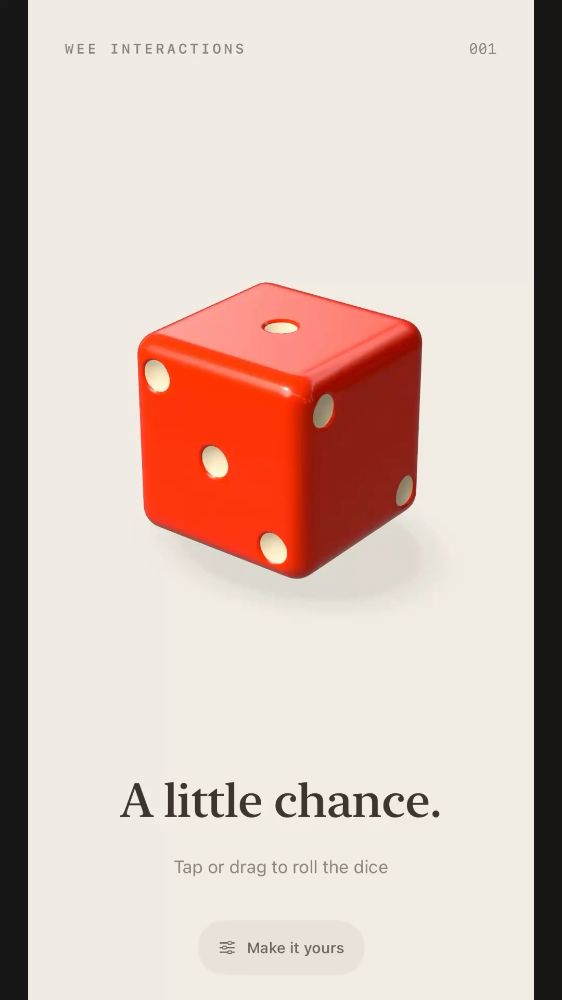

# Wee Dice

**Wee Interactions / 001** — a playful native iOS dice experiment, inspired by a wee bit of Belfast.

A tactile, procedurally modelled die with glossy surfaces, recessed pips, exaggerated motion, and a warm cream backdrop. Built with SwiftUI and RealityKit, without external packages or downloaded models.

## Interactions

- Tap to tumble, or drag and release to influence the roll.
- Art-directed bounce, squash, idle float, and dynamic shadows.
- Accurate upward-facing result, revealed after landing and held briefly before the starting layout returns.
- Subtle landing haptics on iPhone.
- Six colours and three finishes, with saved preferences and live previews.
- Reduced Motion support and accessible roll controls.

## Run

Open `LittleDice.xcodeproj` in Xcode, select the `LittleDice` scheme, choose an iPhone simulator, and run. Requires an iOS 18+ SDK. For a physical iPhone, select your own development team in Signing & Capabilities. The installed app is called **Wee Dice**; the internal target remains LittleDice.

## Verify roll math

```sh
mkdir -p /tmp/wee-dice-checks
xcrun swiftc -module-cache-path /tmp/wee-dice-checks/cache LittleDice/RollMath.swift Tests/RollMathChecks.swift -o /tmp/wee-dice-checks/checks
/tmp/wee-dice-checks/checks
```

Checks cover all 24 landing poses, 1,152 roll paths, bounce geometry, shadow behaviour, and result presentation. Simulator and signed iPhone builds have been exercised; haptic feel requires a physical phone.

## Demo

[Watch the 9:16 demo](Demo/Wee-Dice-9x16.mp4) — 1080 × 1920, 30 fps, approximately 26 seconds, without added captions. Includes tap, drag, bounce, result reveals, and appearance changes. Narrow side borders remain in this export.



[Development notes](Docs/Development-notes.md) record implementation details and verification history. Motion and shadows are controlled for visual character rather than simulated with rigid-body physics.
